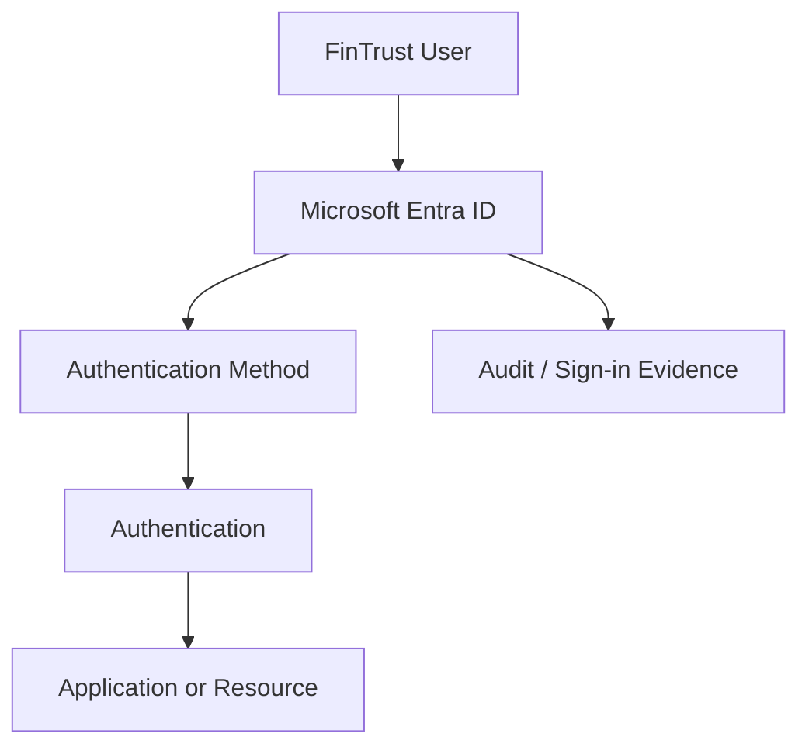

# Authentication Methods

> **SC-300 — Microsoft Identity and Access Administrator**
> **Project:** FinTrust Financial Services
> **Week:** 2
> **Day:** 1

---

## Table of Contents

1. [Learning Objectives](#1-learning-objectives)
2. [FinTrust Financial Services Scenario](#2-fintrust-financial-services-scenario)
3. [Authentication Fundamentals](#3-authentication-fundamentals)
4. [Authentication Methods in Microsoft Entra ID](#4-authentication-methods-in-microsoft-entra-id)
5. [Authentication Methods vs Authentication Policy vs Authentication Strength](#5-authentication-methods-vs-authentication-policy-vs-authentication-strength)
6. [Password Authentication](#6-password-authentication)
7. [Microsoft Authenticator](#7-microsoft-authenticator)
8. [FIDO2 Security Keys](#8-fido2-security-keys)
9. [Passkeys](#9-passkeys)
10. [Windows Hello for Business](#10-windows-hello-for-business)
11. [Temporary Access Pass](#11-temporary-access-pass)
12. [OATH Tokens](#12-oath-tokens)
13. [SMS and Voice Authentication](#13-sms-and-voice-authentication)
14. [Email OTP](#14-email-otp)
15. [Other Authentication Methods to Know](#15-other-authentication-methods-to-know)
16. [Authentication Methods Policy](#16-authentication-methods-policy)
17. [Authentication Method Registration](#17-authentication-method-registration)
18. [System-Preferred Authentication](#18-system-preferred-authentication)
19. [Authentication Strengths](#19-authentication-strengths)
20. [Phishing Resistance](#20-phishing-resistance)
21. [Authentication Method Decision Matrix](#21-authentication-method-decision-matrix)
22. [Human Identities vs Workload Identities](#22-human-identities-vs-workload-identities)
23. [Administrator Roles and Permissions](#23-administrator-roles-and-permissions)
24. [Least Privilege Design](#24-least-privilege-design)
25. [FinTrust Practical Lab](#25-fintrust-practical-lab)
26. [Lab Phase 1 — Inspect Existing Authentication Methods](#26-lab-phase-1--inspect-existing-authentication-methods)
27. [Lab Phase 2 — Create a Test User and Group](#27-lab-phase-2--create-a-test-user-and-group)
28. [Lab Phase 3 — Configure Authentication Methods](#28-lab-phase-3--configure-authentication-methods)
29. [Lab Phase 4 — User Registration](#29-lab-phase-4--user-registration)
30. [Lab Phase 5 — Test Authentication](#30-lab-phase-5--test-authentication)
31. [Lab Phase 6 — Administrator Verification](#31-lab-phase-6--administrator-verification)
32. [PowerShell Fundamentals](#32-powershell-fundamentals)
33. [Microsoft Graph PowerShell](#33-microsoft-graph-powershell)
34. [Microsoft Graph API](#34-microsoft-graph-api)
35. [Portal vs Graph PowerShell vs Graph REST](#35-portal-vs-graph-powershell-vs-graph-rest)
36. [Authentication Methods Automation Exercise](#36-authentication-methods-automation-exercise)
37. [Security Scenario — Unexpected Authenticator Prompts](#37-security-scenario--unexpected-authenticator-prompts)
38. [Authentication Methods Troubleshooting Foundation](#38-authentication-methods-troubleshooting-foundation)
39. [Common Administrator Mistakes](#39-common-administrator-mistakes)
40. [FinTrust Enterprise Authentication Strategy](#40-fintrust-enterprise-authentication-strategy)
41. [Break-Glass Authentication](#41-break-glass-authentication)
42. [Licensing and Prerequisites](#42-licensing-and-prerequisites)
43. [SC-300 Exam Perspective](#43-sc-300-exam-perspective)
44. [SC-300 Scenario-Based Questions](#44-sc-300-scenario-based-questions)
45. [Practical Knowledge Check](#45-practical-knowledge-check)
46. [FinTrust Authentication Methods Challenge](#46-fintrust-authentication-methods-challenge)
47. [GitHub Evidence](#47-github-evidence)
48. [Reusable Lab Documentation Template](#48-reusable-lab-documentation-template)
49. [Day 1 Completion Checklist](#49-day-1-completion-checklist)
50. [What I Can Now Do as an IAM Administrator](#50-what-i-can-now-do-as-an-iam-administrator)
51. [Day 1 → Day 2 Bridge](#51-day-1--day-2-bridge)
52. [Microsoft Official References](#52-microsoft-official-references)

---

# 1. Learning Objectives

By the end of Week 2 - Day 1, I should be able to:

* Explain authentication in the context of Microsoft Entra ID.
* Explain the difference between identification, authentication, authorization, and auditing.
* Explain what an authentication method is.
* Identify important authentication methods supported by Microsoft Entra ID.
* Explain password authentication.
* Explain Microsoft Authenticator.
* Distinguish Authenticator push from Authenticator passwordless authentication.
* Explain FIDO2.
* Explain passkeys.
* Explain Windows Hello for Business.
* Explain Temporary Access Pass (TAP).
* Explain OATH tokens.
* Explain SMS and voice authentication.
* Explain email OTP.
* Explain authentication method policies.
* Explain authentication method registration.
* Explain system-preferred authentication.
* Understand the purpose of authentication strengths.
* Identify phishing-resistant authentication methods.
* Select an appropriate authentication method for a business scenario.
* Understand which Microsoft Entra roles manage authentication.
* Apply least privilege to authentication administration.
* Inspect authentication methods through the Microsoft Entra admin center.
* Register a test authentication method.
* Verify a user's registered authentication methods.
* Use Microsoft Graph PowerShell to inspect authentication methods.
* Understand the relationship between PowerShell, Microsoft Graph PowerShell, Microsoft Graph, and Microsoft Entra ID.
* Troubleshoot basic authentication-method problems.
* Document authentication configuration as an IAM administrator.
* Produce GitHub evidence from an identity-management lab.
* Connect authentication-method knowledge to SC-300 exam scenarios.

---

# 2. FinTrust Financial Services Scenario

## 2.1 Organization

FinTrust Financial Services is a fictional financial-services organization used throughout this project.

The organization uses Microsoft Entra ID as its cloud identity platform.

FinTrust has the following departments:

| Department       | Example users |
| ---------------- | ------------- |
| Finance          | Alice Wanjiku |
| Human Resources  | Brian Otieno  |
| IT               | David Kamau   |
| Cybersecurity    | Grace Njeri   |
| Loans            | James Mwangi  |
| Customer Support | Mary Achieng  |
| Management       | Peter Kariuki |

Existing security groups include:

```text
FT-Finance-Users
FT-HR-Users
FT-IT-Users
FT-Cybersecurity-Users
FT-Loans-Users
FT-CustomerSupport-Users
FT-Management-Users
```

---

## 2.2 The Business Problem

FinTrust does not want users to authenticate using passwords alone.

The organization needs to:

* reduce password-related attacks;
* support stronger authentication;
* support passwordless authentication;
* onboard new employees;
* recover users who lose authentication devices;
* protect administrators;
* support different authentication requirements for different users;
* maintain least privilege for identity administrators;
* provide an auditable authentication architecture.

This creates the need for **authentication methods**.

---

# 3. Authentication Fundamentals

## 3.1 What Is Authentication?

Authentication is the process of verifying that a person or entity is who they claim to be.

A simple identity-security flow is:

```text
Identity
   ↓
Authentication
   ↓
Authorization
   ↓
Access
   ↓
Audit
```

Microsoft describes authentication as the security process that verifies a user's identity before access is granted to applications, services, devices, or networks.

---

## 3.2 Identification

Identification answers:

> **Who are you claiming to be?**

For example:

```text
Username:
alice.wanjiku@fintrust.example
```

The user has identified themselves as Alice.

Identification alone does not prove that the person is Alice.

---

## 3.3 Authentication

Authentication answers:

> **Can you prove that you are Alice?**

The proof could involve:

* password;
* Authenticator;
* FIDO2 security key;
* passkey;
* Windows Hello;
* certificate;
* Temporary Access Pass;
* another supported authentication method.

---

## 3.4 Authorization

Authorization answers:

> **What is Alice allowed to do?**

For example:

```text
Alice
 ↓
Finance group
 ↓
Finance application
 ↓
Read financial reports
```

Authentication establishes the identity.

Authorization determines the permissions.

---

## 3.5 Auditing

Auditing answers:

> **What happened?**

For example:

```text
Alice signed in
        ↓
Authentication succeeded
        ↓
Application accessed
        ↓
Activity recorded
```

Authentication, authorization, and auditing are related but are not the same thing.

---

## 3.6 The Four Concepts

| Concept        | Main question               |
| -------------- | --------------------------- |
| Identification | Who are you claiming to be? |
| Authentication | Prove who you are.          |
| Authorization  | What are you allowed to do? |
| Auditing       | What happened?              |

##### Exam Tip

Do not confuse authentication with authorization.

A user successfully authenticating does **not** automatically mean they are authorized to access every resource.

---

# 4. Authentication Methods in Microsoft Entra ID

## 4.1 What Is an Authentication Method?

An authentication method is a mechanism a user can use to prove their identity during an authentication flow.

Examples include:

* password;
* Microsoft Authenticator;
* FIDO2/passkey;
* Windows Hello for Business;
* Temporary Access Pass;
* SMS;
* voice;
* OATH;
* certificate-based authentication.

Microsoft Entra supports authentication methods for different purposes, including primary authentication, additional authentication/MFA, SSPR, and account recovery. Not every method can be used for every purpose.

---

## 4.2 Authentication Methods Are Not All Equal

One of the most important lessons is:

> **An authentication method is not automatically equivalent to another authentication method.**

For example:

```text
Password
```

is fundamentally different from:

```text
FIDO2 passkey
```

because their security properties are different.

Similarly:

```text
Authenticator push
```

and:

```text
Authenticator passwordless
```

are different authentication experiences.

---

## 4.3 Current Microsoft Entra Authentication Method Landscape

| Method                               |               Primary authentication |                             MFA/secondary use |     Passwordless |                                                   Phishing-resistant | Important consideration                                                    |
| ------------------------------------ | -----------------------------------: | --------------------------------------------: | ---------------: | -------------------------------------------------------------------: | -------------------------------------------------------------------------- |
| Password                             |                                  Yes |                                            No |               No |                                                                   No | Vulnerable to credential attacks                                           |
| Microsoft Authenticator push         |                                   No |                                           Yes |               No |                                                                   No | Stronger than password-only but susceptible to phishing/social engineering |
| Microsoft Authenticator passwordless |                                  Yes |                                            No |              Yes | Not classified by Microsoft as one of its phishing-resistant methods | Better user experience and removes password entry                          |
| Passkey/FIDO2                        |                                  Yes |                                           Yes |              Yes |                                                                  Yes | Strong protection against remote phishing                                  |
| Passkey in Microsoft Authenticator   |                                  Yes |                                           Yes |              Yes |                                                                  Yes | Device-bound passkey experience                                            |
| Synced passkey                       |                                  Yes |                                           Yes |              Yes |                                                                  Yes | Passkey can synchronize through a supported credential provider            |
| Windows Hello for Business           |                                  Yes |                    Yes in supported scenarios |              Yes |                                                                  Yes | Device-bound asymmetric credentials                                        |
| Temporary Access Pass                |                                  Yes |                    Yes in supported scenarios | Bootstrap method |                                                                   No | Temporary onboarding/recovery mechanism                                    |
| Software OATH                        |                                   No |                                           Yes |               No |                                                                   No | Code-based authentication                                                  |
| Hardware OATH                        |                                   No |                                           Yes |               No |                                                                   No | Physical token                                                             |
| SMS                                  |                  Yes for SMS sign-in |                                           Yes |               No |                                                                   No | Vulnerable to attacks such as SIM swapping and phishing                    |
| Voice call                           |                                   No |                                           Yes |               No |                                                                   No | Older/less preferred method                                                |
| Email OTP                            | No for normal member primary sign-in |            SSPR / supported sign-in scenarios |               No |                                                                   No | Useful in specific scenarios                                               |
| Certificate-based authentication     |                                  Yes | Can satisfy MFA when configured appropriately |              Yes |                                                                  Yes | Enterprise certificate infrastructure required                             |

Microsoft's current authentication overview identifies Windows Hello for Business, FIDO2 security keys, synced passkeys, passkeys in Microsoft Authenticator, and certificate-based authentication among its phishing-resistant methods.

---

# 5. Authentication Methods vs Authentication Policy vs Authentication Strength

These three concepts are easy to confuse.

## 5.1 Authentication Method

Answers:

> **What can the user use to authenticate?**

Examples:

```text
Password
Authenticator
FIDO2
TAP
SMS
```

---

## 5.2 Authentication Methods Policy

Answers:

> **Which authentication methods are enabled, and for whom?**

Example:

```text
FIDO2
    ↓
Enabled
    ↓
FT-Cybersecurity-Users
```

The Authentication methods policy is Microsoft's recommended mechanism for managing authentication methods, including modern passwordless methods. Authentication Policy Administrators can configure methods for all users or targeted groups.

---

## 5.3 Authentication Strength

Authentication strength answers:

> **How strong must the authentication be for this access decision?**

Conceptually:

```text
Authentication Method
        ↓
Authentication Strength
        ↓
Access Requirement
```

For example:

```text
FIDO2
Windows Hello for Business
Certificate
```

could satisfy a phishing-resistant requirement.

The authentication-strength requirement is particularly useful when access to a resource must require a particular level of authentication.

The actual enforcement of authentication strengths through Conditional Access will be studied later in:

```text
02-authentication/conditional-access/
```

---

## 5.4 Easy Way to Remember

```text
METHOD
"What can I use?"

POLICY
"Who can use it?"

STRENGTH
"How strong must it be?"
```

---

# 6. Password Authentication

## 6.1 What Is Password Authentication?

A password is a knowledge-based authentication factor.

The user knows something:

```text
Username
+
Password
```

Microsoft Entra validates the credentials and, when authentication succeeds, establishes the user's identity.

---

## 6.2 Why Passwords Are Still Important

Even though Microsoft promotes passwordless authentication, passwords remain important because:

* many organizations still use them;
* legacy applications may depend on them;
* users may need recovery mechanisms;
* passwordless onboarding often requires a bootstrap process;
* administrators need to understand password-based attack paths.

---

## 6.3 Password Risks

Common password attacks include:

### Password spraying

An attacker tries a small number of commonly used passwords against many accounts.

Example:

```text
Password123!
```

against:

```text
Alice
Brian
David
Grace
James
Mary
Peter
```

The attacker avoids repeatedly attacking one account.

---

### Credential stuffing

An attacker obtains username/password combinations from another breach and tries them against FinTrust accounts.

Example:

```text
username@example.com
password-from-old-breach
```

---

### Phishing

The attacker attempts to convince the user to provide credentials to a fraudulent site or service.

---

### Password reuse

A user uses the same password across multiple services.

If one service is compromised, the same password may be attempted against Microsoft 365 or other corporate systems.

---

## 6.4 Password vs Passwordless

| Property                          | Password | Passwordless                  |
| --------------------------------- | -------- | ----------------------------- |
| Requires secret typed by user     | Yes      | Usually no                    |
| Vulnerable to password spraying   | Yes      | No password to spray          |
| Vulnerable to credential stuffing | Yes      | No password credential        |
| Can be phished                    | Yes      | Depends on method             |
| Can be phishing resistant         | No       | Some methods are              |
| User experience                   | Familiar | Often faster after enrollment |
| Recovery planning                 | Required | Still required                |

### Important

Passwordless does **not** automatically mean phishing-resistant.

You must identify the specific authentication method.

---

# 7. Microsoft Authenticator

## 7.1 What Is Microsoft Authenticator?

Microsoft Authenticator is a mobile application that can support multiple authentication experiences for Microsoft Entra accounts.

It can support:

* MFA push notifications;
* passwordless sign-in;
* verification codes;
* passkeys.

Microsoft's current documentation describes these different modes separately.

---

# 7.2 Authenticator Push

The basic flow is:

```text
User enters username/password
          ↓
Microsoft Entra requires additional verification
          ↓
Authenticator notification
          ↓
User approves / completes number matching
          ↓
Authentication continues
```

---

## 7.3 Number Matching

Modern Authenticator push experiences can use number matching.

Instead of simply:

```text
Approve?
YES / NO
```

the user may be shown a number on the sign-in page and asked to enter the same number in the Authenticator application.

Example:

```text
Browser:
Enter 47 in Authenticator
```

The user sees:

```text
47
```

and completes the verification.

This provides additional protection against accidental approvals and notification-fatigue attacks.

---

# 7.4 Notification Fatigue

An attacker may repeatedly send authentication prompts.

Example:

```text
08:01 → Approve?
08:02 → Approve?
08:03 → Approve?
08:04 → Approve?
```

The attacker hopes the user eventually presses:

```text
Approve
```

without carefully checking the request.

This is sometimes called **MFA fatigue** or **push bombing**.

---

# 7.5 Authenticator Push vs Authenticator Passwordless

This distinction is critical.

### Authenticator MFA push

The user may first provide:

```text
Password
```

and then:

```text
Authenticator
```

Conceptually:

```text
Password
   +
Authenticator
   =
MFA
```

---

### Authenticator passwordless

The user can authenticate through the Authenticator passwordless experience without entering the account password.

Conceptually:

```text
Authenticator
   ↓
Passwordless authentication
```

These are different authentication experiences even though both use the Authenticator application.

---

## 7.6 FinTrust Example

For standard employees:

```text
Password
      +
Authenticator
```

may be used during a transition to stronger authentication.

For a mature passwordless environment:

```text
Authenticator passwordless
```

may remove routine password entry.

For highly sensitive administrator accounts, FinTrust should consider phishing-resistant methods such as passkeys/FIDO2 or Windows Hello for Business.

---

# 8. FIDO2 Security Keys

## 8.1 What Is FIDO2?

FIDO2 is an open authentication standard based on public-key cryptography.

Microsoft Entra supports FIDO2 security keys and passkey-based authentication.

The basic concept is:

```text
Private Key
    ↓
Stays protected by authenticator

Public Key
    ↓
Registered with identity provider
```

---

# 8.2 Public-Key Cryptography

Instead of sending a reusable secret such as:

```text
Password123!
```

the authentication system uses a key pair.

```text
Private Key
+
Public Key
```

The private key remains protected by the authenticator.

The public key can be registered with Microsoft Entra ID.

---

# 8.3 Simplified FIDO2 Authentication Flow

```text
User
  ↓
Selects FIDO2/passkey
  ↓
Authenticator requests user verification
  ↓
PIN / biometric / security-key interaction
  ↓
Private key performs cryptographic operation
  ↓
Microsoft Entra verifies response
  ↓
Authentication succeeds
```

The private key is not simply transmitted to Microsoft Entra.

---

# 8.4 Why FIDO2 Is Phishing Resistant

Suppose the legitimate site is:

```text
https://login.microsoftonline.com
```

An attacker creates:

```text
https://evil-login-example.com
```

A properly implemented FIDO2 credential is bound to the legitimate relying-party context.

The attacker cannot simply capture a password or OTP and replay it at the legitimate service.

That is a major reason FIDO2 is considered phishing resistant.

---

# 8.5 Security Key Interaction

A physical security key may require:

* insertion;
* touch;
* PIN;
* biometric verification depending on the authenticator.

The exact experience depends on the security key.

---

# 8.6 FIDO2 Enterprise Use Cases

FinTrust could use FIDO2 for:

* cybersecurity administrators;
* privileged administrators;
* finance administrators;
* high-value accounts;
* users with elevated access;
* phishing-resistant authentication requirements.

---

# 8.7 FIDO2 Limitations

Consider:

* lost security keys;
* replacement;
* registration;
* recovery;
* hardware availability;
* user training;
* compatibility;
* policy configuration.

A secure authentication method still requires an account-recovery strategy.

---

# 9. Passkeys

## 9.1 What Is a Passkey?

A passkey is a credential based on public-key cryptography and modern FIDO/WebAuthn technology.

Passkeys are designed to replace passwords for authentication.

Microsoft Entra currently supports:

* synced passkeys;
* device-bound passkeys on supported FIDO2 security keys;
* device-bound passkeys in Microsoft Authenticator.

Microsoft documents passkeys under its FIDO2 authentication model.

---

# 9.2 Passkey Architecture

Conceptually:

```text
User
 ↓
Passkey provider
 ↓
Private key protected locally
 ↓
Public key registered with Microsoft Entra
```

---

# 9.3 Device-Bound Passkeys

A device-bound passkey remains associated with the device/authenticator where it was created.

Examples include:

* supported security keys;
* passkeys in Microsoft Authenticator.

Microsoft states that passkeys in Authenticator are device-bound.

---

# 9.4 Synced Passkeys

A synced passkey can synchronize through a supported credential provider.

This can improve usability because the credential may be available across supported devices.

However, enterprise policy should determine whether synced or device-bound passkeys are appropriate for a particular group.

Microsoft's current passkey configuration supports profiles that can specify **device-bound** or **synced** passkey types.

---

# 9.5 Passkey vs Password

| Property                   | Password   | Passkey                           |
| -------------------------- | ---------- | --------------------------------- |
| Shared secret              | Yes        | No                                |
| Public/private key model   | No         | Yes                               |
| Password spraying          | Vulnerable | Not applicable                   |
| Credential stuffing        | Vulnerable | Not applicable                    |
| Remote phishing resistance | No         | Yes, for supported FIDO2 passkeys |
| User enters password       | Yes        | No                                |
| Recovery planning          | Required   | Required                          |

---

# 9.6 Passkey vs FIDO2 Security Key

These terms can overlap.

A FIDO2 security key can store a passkey.

A passkey is the credential.

The security key is one possible authenticator that protects the credential.

Therefore:

```text
Passkey
    =
Credential
```

while:

```text
Security Key
    =
Authenticator/device that can hold the credential
```

---

# 9.7 Microsoft Entra Passkey Profiles

Microsoft Entra now supports passkey profiles for more granular configuration.

Profiles can control settings such as:

* attestation;
* passkey type;
* specific authenticator restrictions;
* targeted groups.

Microsoft currently documents up to three passkey profiles, including the default profile.

---

# 10. Windows Hello for Business

## 10.1 What Is Windows Hello for Business?

Windows Hello for Business is a passwordless authentication technology for Windows environments.

It uses asymmetric credentials and ties the credential to the user and device.

---

# 10.2 Windows Hello PIN vs Password

A Windows Hello for Business PIN is **not simply another password**.

A password is generally a reusable secret associated with the account.

A Windows Hello for Business credential uses asymmetric cryptography.

Simplified:

```text
User + Device
       ↓
Windows Hello credential
       ↓
Private key protected by device
       ↓
Public key registered with identity provider
```

---

# 10.3 PIN

The PIN is used to unlock/use the local credential.

It is associated with the specific device.

Therefore:

```text
Device A
PIN 1234
```

does not mean:

```text
Microsoft Entra password = 1234
```

The PIN protects access to the local credential.

---

# 10.4 Biometrics

Windows Hello for Business can also support biometric experiences where the device hardware and configuration permit them.

Examples:

* fingerprint;
* facial recognition.

The biometric is used locally to unlock/use the credential.

---

# 10.5 TPM

A Trusted Platform Module can provide hardware-backed protection for cryptographic keys.

This strengthens the security of the credential.

---

# 10.6 Windows Hello Trust Models

Important deployment concepts include:

* cloud Kerberos trust;
* key trust;
* certificate trust.

These become particularly important in hybrid environments.

---

# 10.7 Microsoft Entra Joined Environment

For cloud-only environments:

```text
Windows device
      ↓
Microsoft Entra joined
      ↓
Windows Hello for Business
      ↓
Microsoft Entra authentication
```

For hybrid environments, additional identity and synchronization considerations apply.

Microsoft's deployment documentation distinguishes cloud-only and hybrid Windows Hello for Business architectures and explains the role of Microsoft Entra and synchronization.

---

# 10.8 Windows Hello Security

Windows Hello for Business is one of Microsoft's phishing-resistant authentication methods.

Microsoft documents Windows Hello for Business as a phishing-resistant method and explains that authentication uses the private portion of the credential while the identity provider validates the corresponding public key.

---

# 11. Temporary Access Pass

## 11.1 What Is TAP?

Temporary Access Pass (TAP) is a time-limited passcode that can be used to bootstrap other authentication methods.

It is particularly useful when a user does not yet have a strong authentication method registered.

---

# 11.2 The Bootstrap Problem

Suppose FinTrust hires:

```text
Brian
```

Brian needs to register:

```text
Microsoft Authenticator
```

But how does Brian securely authenticate for the first time?

This is the bootstrap problem.

TAP can help:

```text
New User
   ↓
Temporary Access Pass
   ↓
Initial authentication
   ↓
Register passwordless method
   ↓
Future authentication
```

Microsoft specifically documents TAP as a method for bootstrapping passwordless authentication methods.

---

# 11.3 TAP Characteristics

A TAP can be configured with:

* limited lifetime;
* one-time use;
* multiple-use behavior where permitted;
* configurable length.

Current Microsoft documentation states that TAP lifetime can be configured within defined limits and that one-time use can be enforced by policy.

---

# 11.4 One-Time TAP

A one-time TAP is designed to be consumed once.

This provides stronger control for sensitive onboarding operations.

For example:

```text
HR creates employee
        ↓
IAM administrator creates TAP
        ↓
Employee uses TAP
        ↓
Employee registers passkey
        ↓
TAP no longer usable
```

---

# 11.5 TAP Security

A TAP should be treated as sensitive.

Do not:

* publish it;
* store it in GitHub;
* send it through insecure channels;
* leave it visible in screenshots.

---

# 11.6 TAP and FinTrust

Use TAP for controlled onboarding of:

* new employees;
* administrators;
* users moving to passwordless authentication;
* users recovering from loss of an authentication method.

---

# 12. OATH Tokens

## 12.1 What Is OATH?

OATH refers to standards used for generating one-time passwords.

Two concepts are important:

```text
TOTP
```

and:

```text
HOTP
```

---

## 12.2 TOTP

Time-based One-Time Password.

The code changes based on time.

Example:

```text
482 913
```

After a short period, a new code is generated.

---

## 12.3 HOTP

HMAC-based One-Time Password.

The generated code is based on a counter rather than time.

---

## 12.4 Software OATH

A software token can generate one-time codes through an application.

---

## 12.5 Hardware OATH

A physical hardware token can generate codes.

Hardware OATH support exists in Microsoft Entra authentication scenarios; Microsoft currently identifies hardware OATH tokens as a preview capability in its authentication-method overview.

---

## 12.6 Authenticator vs OATH

| Feature                  | Authenticator                | OATH                            |
| ------------------------ | ---------------------------- | ------------------------------- |
| Push notifications       | Yes                          | No                              |
| Verification codes       | Yes                          | Yes                             |
| Passwordless             | Yes                          | No                              |
| FIDO2/passkey capability | Yes                          | No                              |
| Hardware token possible  | No                           | Yes                             |
| Common use               | Modern mobile authentication | Token/code-based authentication |

---

# 13. SMS and Voice Authentication

## 13.1 SMS

The user receives a one-time code.

Example:

```text
Microsoft Entra:
Your code is 392841
```

The user enters:

```text
392841
```

---

# 13.2 Why SMS Is Not Ideal

SMS introduces risks such as:

* SIM swapping;
* social engineering;
* phishing;
* phone-number compromise;
* message interception;
* dependence on mobile network availability.

This does not mean:

> "SMS provides no security."

It means:

> SMS can provide useful additional verification but has weaker security properties than phishing-resistant authentication.

---

# 13.3 Voice Authentication

The user receives a phone call and interacts with the verification process.

Voice has similar concerns:

* telephone-network dependency;
* social engineering;
* number compromise;
* weaker phishing resistance.

---

# 13.4 FinTrust Recommendation

For a mature FinTrust environment:

```text
Preferred
   ↓
Passkeys / FIDO2
Windows Hello for Business
Certificate-based authentication

Fallback / transitional
   ↓
Authenticator
OATH

Lower-preference fallback
   ↓
SMS / Voice
```

The exact design depends on business requirements, licensing, devices, and recovery architecture.

---

# 14. Email OTP

## 14.1 What Is Email OTP?

Email OTP is a one-time code sent through email.

It is useful in specific Microsoft Entra scenarios.

Microsoft currently documents Email OTP for SSPR and supported guest sign-in scenarios rather than treating it as a general replacement for strong phishing-resistant authentication.

---

# 14.2 Why Email OTP Is Not Phishing Resistant

Suppose:

```text
User's email
      ↓
OTP
      ↓
Attacker asks for OTP
```

The OTP can potentially be phished.

Therefore:

```text
Email OTP
≠
FIDO2
```

---

# 14.3 B2B Scenario

A guest user may need to authenticate to a resource without having a Microsoft Entra account in the host tenant.

Email OTP can support certain external-user scenarios.

---

# 15. Other Authentication Methods to Know

Microsoft Entra supports additional methods beyond those used in today's primary lab.

Examples include:

* certificate-based authentication;
* QR code authentication;
* Authenticator Lite;
* external MFA;
* platform credentials;
* Verified ID for identity verification/account recovery scenarios.

Not all are appropriate for every tenant or authentication scenario.

Microsoft's current authentication overview distinguishes authentication methods by whether they support primary authentication, MFA, SSPR, or account recovery.

---

# 16. Authentication Methods Policy

## 16.1 What Is the Authentication Methods Policy?

The Authentication methods policy provides centralized control over authentication methods.

It can determine:

```text
Method
   ↓
Enabled / Disabled
   ↓
Target users/groups
   ↓
Configuration parameters
```

Microsoft recommends the Authentication methods policy for managing modern authentication methods.

---

# 16.2 Why Does the Policy Exist?

Imagine FinTrust has 5,000 users.

An administrator does not want:

```text
Every method
+
Every user
+
No scope
```

Instead, FinTrust might design:

```text
Standard users
     ↓
Authenticator

Cybersecurity administrators
     ↓
FIDO2

Privileged administrators
     ↓
Phishing-resistant methods

Frontline/shared devices
     ↓
Specific supported method
```

---

# 16.3 Policy Scope

Authentication methods can be scoped to:

* all users;
* specific groups;
* exclusions where supported.

Microsoft notes that individual-user targeting has been removed from newer Authentication methods policy experiences; targeted groups are recommended instead.

---

# 16.4 Example

```text
FT-Authentication-Lab
        ↓
Microsoft Authenticator
        ↓
Enabled
```

Only users in the intended scope participate in that configuration.

---

# 16.5 Policy Does Not Mean Registration

This is an important distinction.

A method can be:

```text
Enabled by policy
```

without meaning:

```text
The user has registered it
```

For example:

```text
FIDO2
Policy: Enabled
User: Not registered
```

The user still needs to register a FIDO2 credential.

---

# 16.6 Policy Does Not Mean Successful Authentication

A user may have:

```text
Method enabled
+
Method registered
```

and still fail authentication because of another condition.

This is why troubleshooting must consider the entire authentication flow.

---

# 16.7 Portal Location

The Microsoft documentation currently directs administrators to:

```text
Microsoft Entra admin center
    ↓
Entra ID
    ↓
Authentication methods
    ↓
Policies
```

Authentication Policy Administrator is the relevant role for managing the Authentication methods policy.

Portal wording can change, so always verify the current Microsoft portal navigation before documenting production procedures.

---

# 17. Authentication Method Registration

## 17.1 What Is Registration?

Registration is the process by which a user associates an authentication method with their identity.

Example:

```text
User
 ↓
Security info
 ↓
Register Authenticator
 ↓
Authenticator associated with account
```

---

# 17.2 Policy vs Registration

Think of this as:

```text
POLICY
"Authenticator is allowed."

          ↓

REGISTRATION
"Alice registered Authenticator."

          ↓

AUTHENTICATION
"Alice used Authenticator."
```

These are three different states.

---

# 17.3 Registration Experience

The user may use the Microsoft security-info experience to:

* add an authentication method;
* remove an authentication method;
* manage registered methods;
* complete setup.

---

# 17.4 Registration Campaign

A registration campaign can encourage users to register Microsoft Authenticator.

Conceptually:

```text
User signs in
      ↓
User is eligible
      ↓
Microsoft encourages registration
      ↓
User registers Authenticator
```

The purpose is to increase registration coverage.

---

# 17.5 Administrator Verification

An administrator should be able to answer:

> What authentication methods has this user registered?

This is important for:

* troubleshooting;
* account recovery;
* security investigations;
* onboarding;
* offboarding;
* support.

---

# 17.6 Usable vs Non-Usable Methods

Microsoft Entra can show authentication methods that are usable or non-usable.

A method can become non-usable for reasons such as:

* expiration;
* failed attestation;
* policy changes;
* revoked/re-registration conditions.

Microsoft documents this distinction in the Authentication methods administration experience.

---

# 18. System-Preferred Authentication

## 18.1 What Does System-Preferred Mean?

System-preferred authentication allows Microsoft Entra to prefer a stronger available authentication method rather than simply presenting a weaker method first.

The goal is to improve:

* security;
* user experience;
* resistance to weaker authentication choices.

---

## 18.2 Example

Suppose Alice has:

```text
SMS
Authenticator
```

registered.

Instead of always presenting:

```text
SMS
```

the system can prefer:

```text
Authenticator
```

when the policy and authentication flow support it.

---

## 18.3 Why It Matters

A user may have multiple methods.

The existence of a stronger method does not automatically mean the user will always select it.

System-preferred behavior can help move users toward stronger methods.

---

# 19. Authentication Strengths

## 19.1 What Is Authentication Strength?

Authentication strength describes the level/type of authentication required.

Conceptually:

```text
User
 ↓
Authentication method
 ↓
Authentication strength
 ↓
Access decision
```

---

## 19.2 Example

A FinTrust policy might require:

```text
Privileged administrator
       ↓
Phishing-resistant authentication
```

The acceptable methods could include:

```text
FIDO2
Windows Hello for Business
Certificate-based authentication
```

---

## 19.3 Built-In Strengths

Microsoft Entra provides built-in authentication strengths such as:

* multifactor authentication;
* passwordless MFA;
* phishing-resistant MFA.

The exact methods included in a strength depend on Microsoft's current definitions.

---

## 19.4 Custom Authentication Strength

Organizations can create custom authentication strengths to restrict which methods satisfy an access requirement.

Example:

```text
FT-Privileged-Admin-Strength

Allowed:
FIDO2/passkey
Windows Hello for Business
Certificate-based authentication
```

---

## 19.5 Scope of Today's Lesson

Today we are learning:

> **What authentication strength means.**

We are **not** building the full Conditional Access implementation.

That belongs to:

```text
02-authentication/conditional-access/
```

---

# 20. Phishing Resistance

## 20.1 What Is Phishing Resistance?

A phishing-resistant authentication method is designed so that an attacker cannot easily trick the user into giving the attacker a reusable credential that can be replayed against the legitimate service.

---

# 20.2 Comparison

| Method                     | MFA capable | Passwordless |                                                   Phishing resistant |
| -------------------------- | ----------: | -----------: | -------------------------------------------------------------------: |
| Password                   |          No |           No |                                                                   No |
| SMS OTP                    |         Yes |           No |                                                                   No |
| Voice                      |         Yes |           No |                                                                   No |
| Authenticator push         |         Yes |           No |                                                                   No |
| Authenticator passwordless | Yes/primary |          Yes | Not classified by Microsoft as one of its phishing-resistant methods |
| FIDO2/passkey              |         Yes |          Yes |                                                                  Yes |
| Windows Hello for Business |         Yes |          Yes |                                                                  Yes |

Microsoft specifically identifies Windows Hello for Business and passkeys/FIDO2 among its phishing-resistant authentication methods.

---

# 20.3 Why Authenticator Push Is Different

Authenticator push is stronger than password-only authentication because it adds another verification step.

However:

```text
Password
+
Push approval
```

can still be attacked through:

* phishing;
* social engineering;
* MFA fatigue;
* malicious login pages;
* compromised sessions.

Therefore:

```text
MFA
≠
Automatically phishing resistant
```

This distinction is extremely important for SC-300.

---

# 20.4 Phishing-Resistant Principle

The strongest authentication methods generally avoid giving the attacker a reusable secret that can simply be captured and replayed.

This is one reason public-key authentication is so important.

---

# 21. Authentication Method Decision Matrix

## 21.1 FinTrust Recommendations

| Scenario                 | Recommended method                                   | Why                                                |
| ------------------------ | ---------------------------------------------------- | -------------------------------------------------- |
| Standard employee        | Authenticator/passwordless or strong modern method   | Good usability and stronger authentication         |
| Finance administrator    | FIDO2/passkey or Windows Hello                       | Finance privileges justify stronger authentication |
| Privileged administrator | Phishing-resistant method                            | Protects high-impact identity                      |
| New employee onboarding  | TAP + registration                                   | Solves bootstrap problem                           |
| Emergency bootstrap      | Controlled TAP/recovery process                      | Temporary and auditable                            |
| High-risk authentication | Phishing-resistant authentication                    | Reduces phishing risk                              |
| User without smartphone  | FIDO2 security key                                   | Does not require smartphone                        |
| Executive                | Strong phishing-resistant method                     | High-value account                                 |
| Service account          | Managed identity/service principal/workload identity | Human authentication methods are inappropriate     |

---

# 22. Human Identities vs Workload Identities

## 22.1 Human Identity

A human identity represents a person.

Example:

```text
Alice Wanjiku
```

Human users may use:

* password;
* Authenticator;
* FIDO2;
* passkey;
* Windows Hello;
* TAP.

---

## 22.2 Workload Identity

A workload identity represents a software workload.

Examples:

* service principal;
* managed identity;
* application identity.

Example:

```text
Application
     ↓
Managed Identity
     ↓
Azure resource
```

---

## 22.3 Why This Matters

Do not create a fake human account just because an application needs access.

Bad design:

```text
finance-app@fintrust
Password123!
```

Better design:

```text
Application
     ↓
Managed Identity / Service Principal
     ↓
Assigned permissions
```

---

## 22.4 SC-300 Connection

When a question describes an application needing Azure resource access, think:

```text
Workload identity
```

When a question describes an employee signing in, think:

```text
Human identity
```

---

# 23. Administrator Roles and Permissions

Authentication administration is privileged work.

Microsoft's current role comparison distinguishes the following roles.

---

## 23.1 Global Administrator

Global Administrator has extremely broad directory permissions.

It can manage authentication-related configurations but should **not** be the default account used for routine authentication administration.

### Principle

```text
Global Administrator
       ↓
Emergency / high-impact administrative operations
```

not:

```text
Global Administrator
       ↓
Every daily IAM task
```

---

# 23.2 Authentication Policy Administrator

The Authentication Policy Administrator manages authentication policies.

This includes management of:

* Authentication methods policy;
* tenant-level MFA settings;
* password protection policy;
* related authentication policy configuration.

Microsoft's current role documentation identifies Authentication Policy Administrator as the role responsible for managing the authentication methods policy.

---

# 23.3 Authentication Administrator

Authentication Administrator can manage authentication methods for appropriate users, particularly non-administrative users and certain other scoped populations.

It is intended for user-level authentication administration rather than tenant-wide authentication policy management.

---

# 23.4 Privileged Authentication Administrator

Privileged Authentication Administrator has broader authentication-management capabilities, including authentication methods for all users.

Because it can affect privileged identities, it must be protected carefully.

Microsoft's current role comparison identifies:

| Role                                    |      User authentication methods | Authentication policy |
| --------------------------------------- | -------------------------------: | --------------------: |
| Authentication Administrator            |         Yes, for supported users |                    No |
| Privileged Authentication Administrator |               Yes, for all users |                    No |
| Authentication Policy Administrator     | No direct user-method management |                   Yes |
| Global Administrator                    |      Broad tenant administration |                   Yes |

---

# 24. Least Privilege Design

## 24.1 Principle

Least privilege means:

> Give an administrator only the permissions required to perform the assigned task.

---

## 24.2 FinTrust Example

Suppose Kelvin's job is:

> Manage the Authentication methods policy.

Do not automatically assign:

```text
Global Administrator
```

Instead consider:

```text
Authentication Policy Administrator
```

---

## 24.3 Another Example

Suppose an IAM support analyst needs to manage authentication methods for standard employees.

An Authentication Administrator may be more appropriate than Global Administrator, depending on the exact scope and task.

---

## 24.4 Why This Matters

Authentication administrators can potentially modify credentials or authentication methods.

That means an overly privileged authentication administrator may create an account-takeover path.

Microsoft explicitly classifies authentication-related permissions as privileged and warns that credential/authentication changes can lead to privilege escalation.

---

# 25. FinTrust Practical Lab

# Lab — FinTrust Authentication Methods Foundation

---

## 25.1 Objective

In this lab, I will:

1. inspect the authentication-method configuration;
2. create a controlled test group;
3. create/select a test user;
4. configure a suitable authentication method;
5. register the method;
6. authenticate using the method;
7. verify the registered method;
8. inspect the method using Microsoft Graph PowerShell;
9. document the configuration;
10. evaluate the security design.

---

## 25.2 Scenario

FinTrust's IAM team is testing modern authentication methods before introducing stronger authentication to production users.

The security team has requested:

> Create a controlled authentication-method pilot without changing the authentication experience for the entire tenant.

---

## 25.3 Prerequisites

You need:

* access to a Microsoft Entra tenant;
* a test user;
* appropriate administrative permissions;
* Microsoft Entra admin center access;
* Microsoft Graph PowerShell;
* a mobile device if testing Authenticator;
* a supported browser;
* permission to create/manage the test group.

---

## 25.4 Recommended Lab Principle

Do **not** change tenant-wide authentication settings unnecessarily.

Use:

```text
Pilot group
```

rather than:

```text
All users
```

whenever the feature allows scoped configuration.

---

## 25.5 Architecture



---

# 26. Lab Phase 1 — Inspect Existing Authentication Methods

## 26.1 Open Microsoft Entra Admin Center

Navigate to the Microsoft Entra administration area.

Current Microsoft documentation places authentication-method configuration under:

```text
Entra ID
    ↓
Authentication methods
    ↓
Policies
```

The exact portal interface may change over time, so verify the current menu structure if your tenant displays a slightly different layout.

---

## 26.2 Record the Existing Configuration

Before making changes, record:

| Method        | Enabled? | Target | Notes |
| ------------- | -------- | ------ | ----- |
| Authenticator |          |        |       |
| FIDO2/Passkey |          |        |       |
| TAP           |          |        |       |
| SMS           |          |        |       |
| Voice         |          |        |       |
| OATH          |          |        |       |

---

## 26.3 Evidence

Capture:

```text
01-authentication-methods-overview.png
```

### It proves

That you inspected the tenant's authentication-method configuration before making changes.

### Do not expose

* passwords;
* TAP values;
* QR secrets;
* private keys;
* personal phone numbers;
* sensitive user information.

---

# 27. Lab Phase 2 — Create a Test User and Group

## 27.1 Test Group

Create:

```text
FT-Authentication-Lab
```

### Purpose

The group will act as the pilot scope for today's experiment.

---

## 27.2 Test User

Create:

```text
FT-AuthTest-01
```

Example:

```text
Display name:
FT Auth Test 01

Department:
IT

Job title:
Authentication Lab User
```

Do not assign administrative roles.

---

## 27.3 Why Use a Test User?

A dedicated test identity provides:

* isolation;
* repeatability;
* easier troubleshooting;
* reduced production risk;
* clearer evidence.

---

## 27.4 Evidence

Capture:

```text
02-test-group.png
03-test-user.png
```

---

# 28. Lab Phase 3 — Configure Authentication Methods

## 28.1 Pilot Method

For the first lab, use:

```text
Microsoft Authenticator
```

because it is practical and does not require purchasing a FIDO2 hardware key.

---

## 28.2 Configuration Logic

The configuration should follow:

```text
Authentication Method
        ↓
Enabled
        ↓
Pilot Group
        ↓
Test User
        ↓
Registration
```

---

## 28.3 Change Record

Document:

| Item                      | Value                          |
| ------------------------- | ------------------------------ |
| Method                    | Microsoft Authenticator        |
| Scope                     | FT-Authentication-Lab          |
| Test user                 | FT-AuthTest-01                 |
| Reason                    | Authentication-method training |
| Production users affected | None intended                  |
| Risk                      | Controlled pilot               |

---

## 28.4 What We Changed

> We enabled the selected authentication method for a controlled test population rather than changing the method for the entire tenant.

---

## 28.5 Why We Changed It

To:

* test the method;
* understand registration;
* validate user experience;
* produce evidence;
* minimize production risk.

---

## 28.6 Security Implication

The pilot limits the blast radius of an incorrect configuration.

---

## 28.7 Evidence

Capture:

```text
04-method-configuration.png
```

---

# 29. Lab Phase 4 — User Registration

## 29.1 Registration Flow

The user should register the configured authentication method.

Conceptually:

```text
User signs in
      ↓
Authentication method registration
      ↓
Microsoft Authenticator setup
      ↓
Account linked
      ↓
Registration completed
```

---

## 29.2 What the User Sees

Depending on the current Microsoft experience and tenant configuration, the user may be prompted to configure Microsoft Authenticator through the security-information registration experience.

The exact UI may change.

---

## 29.3 Administrator Configuration vs User Registration

Remember:

```text
Administrator:
"Authenticator is enabled."

User:
"I registered Authenticator."
```

The first is a policy/configuration state.

The second is a user-registration state.

---

## 29.4 Evidence

Capture:

```text
05-user-registration.png
```

Do not capture:

* QR codes containing secrets;
* recovery codes;
* TAP codes;
* private keys.

---

# 30. Lab Phase 5 — Test Authentication

## 30.1 Authentication Flow

Document:

```text
Before
  ↓
Registration
  ↓
Authentication attempt
  ↓
Authenticator interaction
  ↓
Authentication success
  ↓
Application/resource access
```

---

## 30.2 Test Matrix

| Test                                        | Expected result       | Actual result | Status | Evidence |
| ------------------------------------------- | --------------------- | ------------- | ------ | -------- |
| User can register method                    | Registration succeeds |               |        |          |
| User sees configured method                 | Method available      |               |        |          |
| User completes authentication               | Sign-in succeeds      |               |        |          |
| Authentication method appears in admin view | Method visible        |               |        |          |
| Graph can retrieve method                   | Method returned       |               |        |          |

---

## 30.3 Evidence

Capture:

```text
06-authentication-test.png
```

Avoid screenshots containing:

* passwords;
* authentication codes;
* session tokens;
* QR secrets.

---

# 31. Lab Phase 6 — Administrator Verification

## 31.1 Verify the User

Locate:

```text
FT-AuthTest-01
```

Inspect the user's authentication methods.

---

## 31.2 What Should Be Verified?

Look for information such as:

* authentication method type;
* registration state;
* usability;
* device/display information where available;
* method status.

Microsoft documents that the portal can distinguish usable and non-usable authentication methods and can show reasons why a method is unusable.

---

## 31.3 Evidence

Capture:

```text
07-admin-verification.png
```

---

# 32. PowerShell Fundamentals

## 32.1 What Is PowerShell?

PowerShell is a command shell and scripting language.

Example:

```powershell
Get-Process
```

PowerShell itself is not Microsoft Graph.

---

# 32.2 What Is Microsoft Graph PowerShell?

Microsoft Graph PowerShell is a collection of PowerShell modules/cmdlets used to communicate with Microsoft Graph.

Therefore:

```text
PowerShell
    ↓
Microsoft Graph PowerShell
    ↓
Microsoft Graph API
    ↓
Microsoft Entra ID
```

This distinction is important.

---

## 32.3 The Simple Mental Model

Think:

```text
PowerShell
=
Language / shell
```

while:

```text
Microsoft Graph PowerShell
=
PowerShell interface for Microsoft Graph
```

---

# 33. Microsoft Graph PowerShell

## 33.1 Install the Microsoft Graph Module

A common installation approach is:

```powershell
Install-Module Microsoft.Graph -Scope CurrentUser
```

If the module is already installed, check its version:

```powershell
Get-InstalledModule Microsoft.Graph
```

---

## 33.2 Connect to Microsoft Graph

Use only the permissions necessary for the task.

Example:

```powershell
Connect-MgGraph -Scopes "UserAuthenticationMethod.Read.All"
```

The exact permission requirement depends on the operation and whether you are acting on your own account or another user's account.

---

## 33.3 Check the Connection

```powershell
Get-MgContext
```

Review:

* account;
* tenant;
* scopes;
* authentication type.

---

## 33.4 Why Check `Get-MgContext`?

Suppose you think you connected to:

```text
FinTrust tenant
```

but your PowerShell session is actually connected to:

```text
Another tenant
```

You could perform actions against the wrong environment.

Always verify context.

---

# 33.1 Retrieve a User

Example:

```powershell
Get-MgUser -UserId "FT-AuthTest-01@yourtenantdomain"
```

Or use the actual UPN:

```powershell
$user = Get-MgUser -UserId "ft-authtest-01@yourtenantdomain"
$user
```

---

# 33.2 Retrieve Authentication Methods

Microsoft Graph PowerShell provides:

```powershell
Get-MgUserAuthenticationMethod
```

Example:

```powershell
Get-MgUserAuthenticationMethod -UserId $user.Id
```

Microsoft documents `Get-MgUserAuthenticationMethod` for retrieving a user's registered authentication methods.

---

# 33.3 Inspect the Output

The output can include objects representing authentication methods.

You may see types corresponding to methods such as:

```text
Password
Phone
Microsoft Authenticator
FIDO2
Windows Hello
Temporary Access Pass
OATH
```

The exact returned objects depend on what is registered.

---

# 33.4 More Useful Output

Example:

```powershell
Get-MgUserAuthenticationMethod -UserId $user.Id |
    Select-Object Id, AdditionalProperties
```

Depending on the module version and returned object type, the useful details may appear in `AdditionalProperties`.

---

# 33.5 Graph SDK Cmdlet vs REST API

Microsoft's Graph documentation shows authentication-method operations such as:

```powershell
Get-MgUserAuthenticationMethod
```

corresponding to Graph requests against:

```text
/users/{id}/authentication/methods
```

---

# 33.6 Required Permissions

For delegated access to another user's authentication methods, appropriate Microsoft Graph permissions and an appropriate Microsoft Entra role are required.

Microsoft documents `UserAuthenticationMethod.Read.All` for reading users' authentication methods in supported delegated scenarios.

Do not request broad permissions just because they are available.

Use the least privilege necessary.

---

# 33.7 Read vs Write

Prefer read-only operations during learning.

For example:

```powershell
Get-MgUserAuthenticationMethod
```

is safer for learning than immediately writing or deleting authentication methods.

---

# 34. Microsoft Graph API

## 34.1 What Is Microsoft Graph?

Microsoft Graph is Microsoft's API layer for interacting with Microsoft 365 and Microsoft Entra resources.

Conceptually:

```text
Portal
   ↓
Microsoft Graph
   ↓
Microsoft Entra
```

Graph is particularly valuable when an organization wants:

* automation;
* integration;
* repeatability;
* programmatic administration.

---

# 34.2 Authentication Method Endpoint

A representative Graph request for a user's authentication methods is:

```http
GET https://graph.microsoft.com/v1.0/users/{user-id-or-upn}/authentication/methods
```

Microsoft documents the authentication-method resource and the corresponding `/users/{id}/authentication/methods` endpoint.

---

# 34.3 What the Request Means

```text
GET
```

means:

> Retrieve information.

```text
/users/{id}
```

identifies the user.

```text
/authentication/methods
```

identifies the user's authentication-method collection.

---

# 34.4 Example Conceptual Response

A response may contain objects such as:

```json
{
  "value": [
    {
      "@odata.type": "#microsoft.graph.microsoftAuthenticatorAuthenticationMethod",
      "id": "..."
    }
  ]
}
```

The exact properties depend on the authentication-method object.

---

# 34.5 Never Expose Access Tokens

Never place this in GitHub:

```text
Authorization: Bearer eyJ...
```

Never publish:

* access tokens;
* refresh tokens;
* client secrets;
* private keys;
* TAP values;
* OTP secrets.

---

# 35. Portal vs Graph PowerShell vs Graph REST

| Task                        | Portal         | Graph PowerShell       | Graph REST             |
| --------------------------- | -------------- | ---------------------- | ---------------------- |
| View user                   | Excellent      | Excellent              | Excellent              |
| View authentication methods | Excellent      | Excellent              | Excellent              |
| Configure common methods    | Excellent      | Depends on API support | Depends on API support |
| Bulk operations             | Limited/manual | Strong                 | Strong                 |
| Automation                  | Limited        | Strong                 | Very strong            |
| Repeatability               | Moderate       | High                   | High                   |
| Learning value              | High           | Very high              | Very high              |
| Ease of use                 | Highest        | Medium                 | Lower                  |
| API-level control           | Limited        | High                   | Highest                |

---

## 35.1 When to Use the Portal

Use the portal when:

* learning;
* performing one-off administration;
* visually inspecting configuration;
* troubleshooting interactively.

---

## 35.2 When to Use Graph PowerShell

Use Graph PowerShell when:

* repeating administrative tasks;
* collecting information;
* scripting;
* performing controlled bulk operations;
* generating reports.

---

## 35.3 When to Use Graph REST

Use Graph REST when:

* building applications;
* integrating systems;
* requiring API-level automation;
* working outside PowerShell;
* testing exact API behavior.

---

# 36. Authentication Methods Automation Exercise

## Objective

Create a read-only report of users and their registered authentication methods.

---

## 36.1 Basic Approach

```powershell
Connect-MgGraph -Scopes "User.Read.All", "UserAuthenticationMethod.Read.All"

$users = Get-MgUser -All -Property Id,DisplayName,UserPrincipalName,Department

foreach ($user in $users) {
    $methods = Get-MgUserAuthenticationMethod -UserId $user.Id

    [PSCustomObject]@{
        DisplayName       = $user.DisplayName
        UserPrincipalName = $user.UserPrincipalName
        Department        = $user.Department
        AuthenticationMethods = ($methods.AdditionalProperties.'@odata.type' -join ", ")
    }
}
```

> **Lab note:** Graph SDK object shapes can vary by module version. Treat this as a learning/reporting pattern and inspect the returned objects before relying on a specific property for production automation.

---

## 36.2 Better Development Process

Do not immediately automate all 32+ users.

Start with:

```text
1 user
```

then:

```text
2 users
```

then:

```text
pilot group
```

then:

```text
larger population
```

---

## 36.3 Why?

This reduces:

* accidental changes;
* API mistakes;
* permission problems;
* unexpected data output;
* troubleshooting complexity.

---

# 37. Security Scenario — Unexpected Authenticator Prompts

## 37.1 Scenario

Grace works in Finance.

She reports:

> "My phone keeps asking me to approve Microsoft sign-ins, but I am not trying to sign in."

This is a security concern.

---

## 37.2 First Principle

Do not tell Grace:

> "Just approve it."

Instead:

> Do not approve unexpected authentication requests.

---

## 37.3 IAM Administrator Thinking

Check:

1. Which authentication methods are registered?
2. Is Authenticator registered?
3. Is the method still expected?
4. Did the user initiate the sign-in?
5. Are there suspicious registration changes?
6. Are there unusual sign-in events?
7. Does the user recognize the device?
8. Should the method be removed/re-registered?
9. Should the incident be escalated?

---

## 37.4 Important Boundary

This incident naturally leads into:

* sign-in logs;
* Conditional Access;
* Identity Protection;
* risk investigation.

Those are covered later in Week 2.

Today we are focusing on:

```text
Authentication methods
+
Registration
+
Method security
```

---

# 38. Authentication Methods Troubleshooting Foundation

Detailed troubleshooting will be covered Saturday.

Today we establish the foundation.

| Problem                            | Possible cause                    | What to check                     | Likely action                        |
| ---------------------------------- | --------------------------------- | --------------------------------- | ------------------------------------ |
| User cannot register Authenticator | Method not enabled/scoped         | Authentication methods policy     | Check policy scope                   |
| Method unavailable                 | User not targeted                 | Group membership                  | Verify target group                  |
| FIDO2 unavailable                  | Policy/configuration/device issue | FIDO2/passkey policy              | Check policy and authenticator       |
| TAP not working                    | Expired/not in scope              | TAP policy and lifetime           | Issue a new controlled TAP           |
| User lost phone                    | Device unavailable                | Registered methods                | Use recovery/re-registration process |
| Unexpected prompts                 | Suspicious authentication attempt | User methods and sign-in activity | Do not approve; investigate/escalate |
| Registration fails                 | Browser/device/policy issue       | Registration flow and policy      | Test controlled registration         |

---

# 39. Common Administrator Mistakes

## 39.1 Using Global Administrator for Everything

### Mistake

```text
Global Administrator
       ↓
Every task
```

### Problem

Excessive privilege increases the blast radius of mistakes or compromise.

### Better

Use:

```text
Authentication Policy Administrator
```

for policy tasks where appropriate.

Use:

```text
Authentication Administrator
```

for appropriate user-level authentication tasks.

---

## 39.2 Enabling Every Method

### Mistake

```text
Enable everything
```

### Problem

The organization loses control over:

* security;
* user experience;
* recovery;
* support;
* authentication assurance.

---

## 39.3 Assuming MFA = Phishing Resistant

Wrong:

```text
MFA
=
Phishing resistant
```

Correct:

```text
Some MFA methods
=
Phishing resistant

Others
=
Not phishing resistant
```

---

## 39.4 Confusing Passwordless With Phishing Resistant

Passwordless is not a single security level.

For example:

```text
Passwordless
```

can refer to different technologies with different security properties.

Always identify the actual method.

---

## 39.5 Ignoring Registration

An administrator may enable:

```text
FIDO2
```

but forget that users must still:

```text
Register FIDO2
```

---

## 39.6 Ignoring Recovery

Strong authentication without recovery planning can lock legitimate users out.

---

## 39.7 Testing in Production

Do not test an authentication policy against:

```text
All users
```

when a pilot group can be used.

---

## 39.8 Publishing Secrets

Never publish:

* passwords;
* TAP codes;
* QR enrollment secrets;
* private keys;
* access tokens;
* recovery codes.

---

## 39.9 Applying Human Authentication Methods to Applications

Do not create a human account simply to give an application an identity.

Use appropriate workload identity mechanisms.

---

# 40. FinTrust Enterprise Authentication Strategy

## 40.1 Standard Users

Recommended direction:

```text
Authenticator / passwordless
        ↓
Passkey where supported
```

Reason:

* usability;
* improved security;
* gradual migration.

---

## 40.2 Finance Users

Finance users handle sensitive information.

Recommended:

```text
Phishing-resistant authentication
```

where practical.

Examples:

* FIDO2/passkey;
* Windows Hello for Business.

---

## 40.3 HR Users

HR handles:

* employee records;
* personal information;
* sensitive organizational data.

Use strong authentication and controlled recovery.

---

## 40.4 IT Administrators

IT administrators have broader privileges.

Recommended:

```text
Phishing-resistant authentication
```

with separate administrative accounts.

---

## 40.5 Cybersecurity Administrators

Cybersecurity administrators are high-value targets.

Recommended:

```text
FIDO2/passkey
or
Windows Hello for Business
```

with strong access policies.

---

## 40.6 Global Administrators

Global Administrators should use:

```text
Phishing-resistant authentication
+
Dedicated privileged account
+
Break-glass strategy
+
Monitoring
```

---
