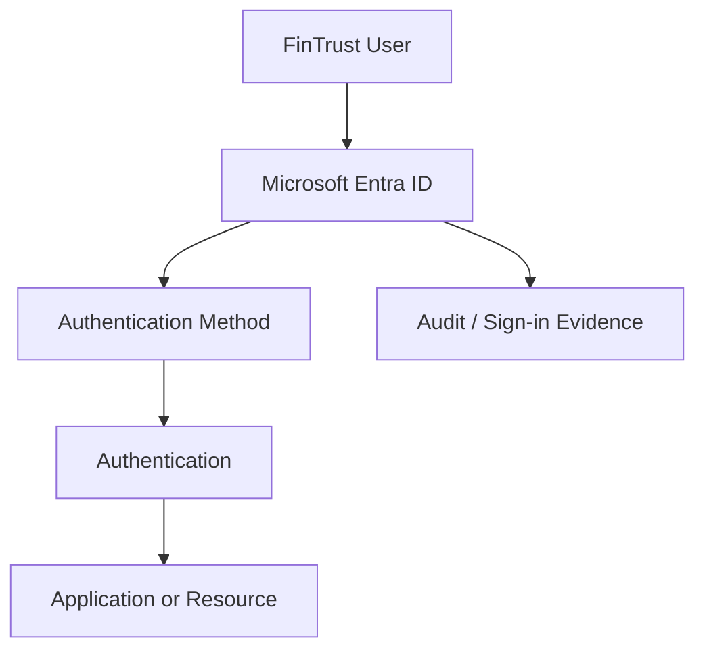
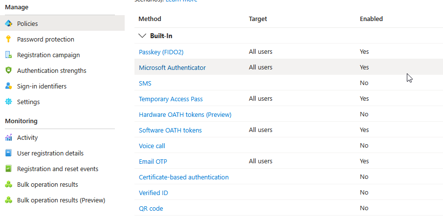
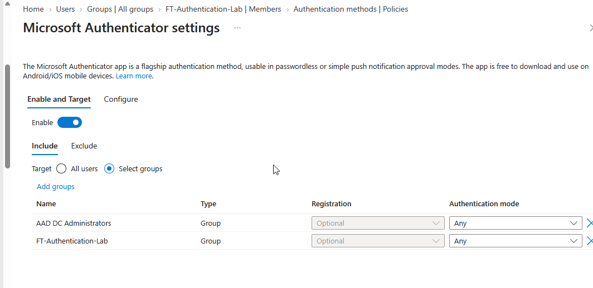
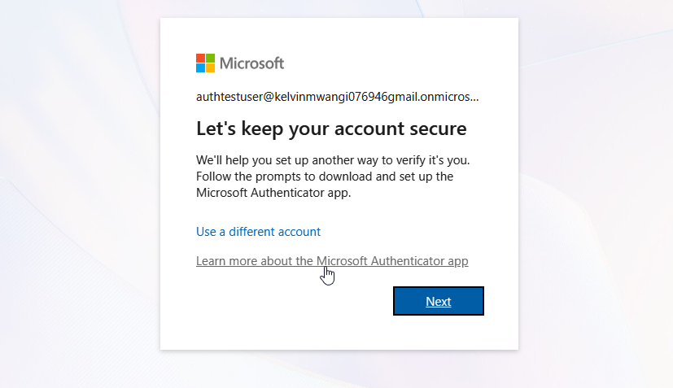
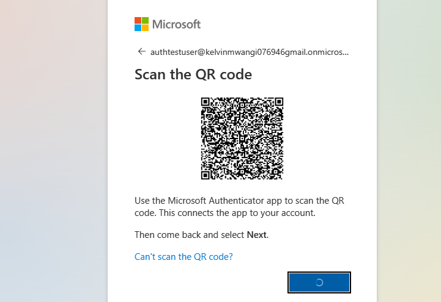
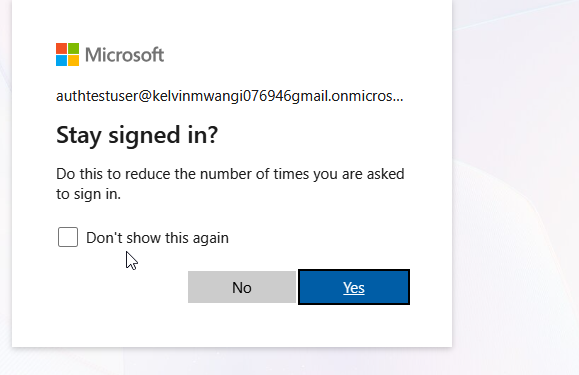
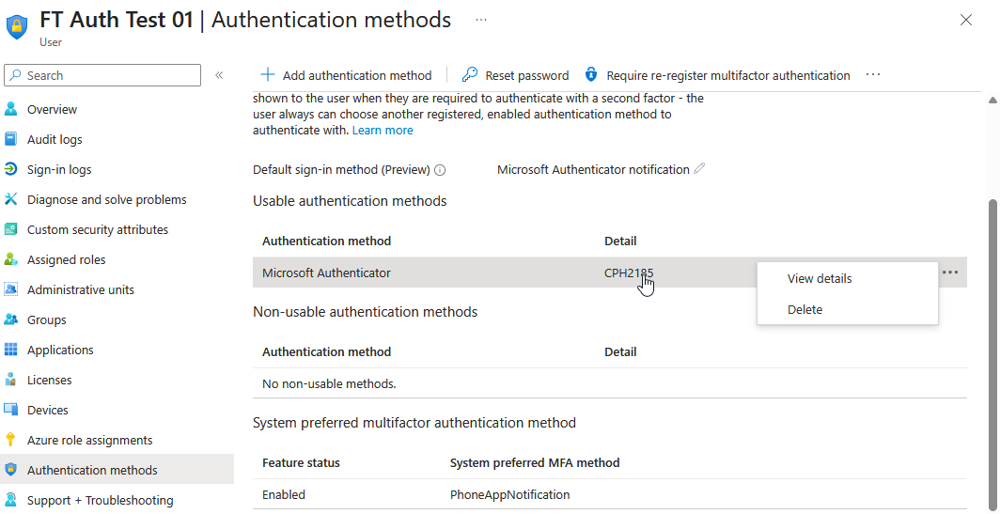

# FinTrust Practical Lab

## Lab — FinTrust Authentication Methods Foundation

---

## 1.1 Objective

In this lab, I will:

1. inspect the authentication-method configuration;
2. create a controlled test group;
3. create/select a test user;
4. configure a suitable authentication method;
5. register the method;
6. authenticate using the method;
7. verify the registered method;
8. inspect the method using Microsoft Graph PowerShell;
9. document the configuration;
10. evaluate the security design.

---

## 1.2 Scenario

FinTrust's IAM team is testing modern authentication methods before introducing stronger authentication to production users.

The security team has requested:

> Create a controlled authentication-method pilot without changing the authentication experience for the entire tenant.

---

## 1.3 Prerequisites

You need:

* access to a Microsoft Entra tenant;
* a test user;
* appropriate administrative permissions;
* Microsoft Entra admin center access;
* Microsoft Graph PowerShell;
* a mobile device if testing Authenticator;
* a supported browser;
* permission to create/manage the test group.

---

## 1.4 Recommended Lab Principle

Do **not** change tenant-wide authentication settings unnecessarily.

Use:

```text
Pilot group
```

rather than:

```text
All users
```

whenever the feature allows scoped configuration.

---

## 1.5 Architecture



---

# 2 Lab Phase 1 — Inspect Existing Authentication Methods

## 2.1 Open Microsoft Entra Admin Center

Navigate to the Microsoft Entra administration area.

Current Microsoft documentation places authentication-method configuration under:

```text
Entra ID
    ↓
Authentication methods
    ↓
Policies
```

The exact portal interface may change over time, so verify the current menu structure if your tenant displays a slightly different layout.

---

## 2.2 Record the Existing Configuration

Before making changes, record:

| Method        | Enabled? | Target |
| ------------- | -------- | ------ |
| Authenticator |    YES   | All Users |
| FIDO2/Passkey |    Yes   | All Users |
| TAP           |    Yes   | All Users |
| SMS           |     -    |    No    |
| Voice         |     -    |    No    |
| OATH          |     -    |    No   |




### Do not expose

* passwords;
* TAP values;
* QR secrets;
* private keys;
* personal phone numbers;
* sensitive user information.

---

# 3. Lab Phase 2 — Create a Test User and Group

## 3.1 Test Group

Create:

```text
FT-Authentication-Lab
```

## 3.2 Test User

Create:

```text
FT-AuthTest-01
```

Department:
IT

Job title:
Authentication Lab User


Do not assign administrative roles.

---

#### Why Use a Test User?

A dedicated test identity provides:

* isolation;
* repeatability;
* easier troubleshooting;
* reduced production risk;
* clearer evidence.

---

## 3.3Evidence


---

# 4. Lab Phase 3 — Configure Authentication Methods

## 4.1 Pilot Method

For the first lab, use:

```text
Microsoft Authenticator
```

because it is practical and does not require purchasing a FIDO2 hardware key.

---

## 4.2 Configuration Logic

The configuration should follow:

```text
Authentication Method
        ↓
Enabled
        ↓
Pilot Group
        ↓
Test User
        ↓
Registration
```
---

## 4.3 Change Record

Document:

| Item                      | Value                          |
| ------------------------- | ------------------------------ |
| Method                    | Microsoft Authenticator        |
| Scope                     | FT-Authentication-Lab          |
| Test user                 | FT-AuthTest-01                 |
| Reason                    | Authentication-method training |
| Production users affected | None intended                  |
| Risk                      | Controlled pilot               |

---

## 4.4 What We Changed

> We enabled the selected authentication method for a controlled test population rather than changing the method for the entire tenant.

---

## 4.5 Why We Changed It

To:

* test the method;
* understand registration;
* validate user experience;
* produce evidence;
* minimize production risk.

---

## 4.6 Security Implication

The pilot limits the blast radius of an incorrect configuration.

---

## 4.7 Evidence

Capture:



---

# 5. Lab Phase 4 — User Registration

## 5.1 Registration Flow

The user should register the configured authentication method.

Conceptually:

```text
User signs in
      ↓
Authentication method registration
      ↓
Microsoft Authenticator setup
      ↓
Account linked
      ↓
Registration completed
```

---

## 5.2 What the User Sees

Depending on the current Microsoft experience and tenant configuration, the user may be prompted to configure Microsoft Authenticator through the security-information registration experience.

---

## 5.3 Administrator Configuration vs User Registration

Remember:

```text
Administrator:
"Authenticator is enabled."

User:
"I registered Authenticator."
```

The first is a policy/configuration state.

The second is a user-registration state.

User X have (Authenticator, TAP, Passkey, Software OATH token & Email OTP) where these are policy state enabled but still choose to use Passkey to sign in which is user-registration state.


---

# 6. Lab Phase 5 — Test Authentication

## 6.1 Authentication Flow

Document:

```text
Before
  ↓
Registration
  ↓
Authentication attempt
  ↓
Authenticator interaction
  ↓
Authentication success
  ↓
Application/resource access
```
---

## 6.2 Evidence







---

# 7. Lab Phase 6 — Administrator Verification

## 7.1 Verify the User

Locate:

```text
FT-AuthTest-01
```

Inspect the user's authentication methods.



---

## 7.2 What Should Be Verified?

* authentication method type? Microsoft Authenticator
* device/display information where available; CPH2185

Also note that the Authentication method can be deleted.

Microsoft documents that the portal can distinguish usable and non-usable authentication methods and can show reasons why a method is unusable.

---
## 8 Configuring Other Authentication Methods

> ### **1. Common configuration procedure:** 
>
> Microsoft Entra ID uses an almost similar workflow for configuring supported authentication methods, including Microsoft Authenticator, FIDO2/passkeys, Temporary Access Pass (TAP), SMS, voice calls, and OATH tokens. The administrator navigates to **Microsoft Entra ID → Authentication methods → Policies**, selects the required method, reviews its settings, enables it where appropriate, and configures the supported target scope. The administrator must also confirm the method's prerequisites and permissions before applying the change. However, not every method has identical settings, dependencies, or configuration requirements.
>
> ### **2. Applying the configuration to groups or individual users:**
>
>Where the authentication-method policy supports group targeting, the administrator can enable the method for a selected group, such as `FT-Authentication-Lab`, rather than the entire tenant. This supports controlled pilots and gradual deployment. Some methods or settings have different targeting capabilities, so the available options must be checked in the portal. For an individual-user test, use a dedicated test account and verify that the user falls within the policy's effective scope. Do not assume that every authentication-method policy supports direct targeting of an individual user.
>
>**3. User registration and method-specific requirements:**  
>
>Enabling an authentication method does not automatically register it for every user. After the policy is configured, the user may need to register the credential or device through the appropriate security-information or authentication setup process. For example, Microsoft Authenticator requires app registration; FIDO2/passkeys require a supported authenticator and credential registration; and TAP requires an administrator to issue a temporary pass according to the configured policy. OATH tokens, SMS, and voice authentication have their own setup and registration requirements. Windows Hello for Business also has device and deployment prerequisites. Therefore, the administrator must follow the procedure for the specific method rather than assuming that every method is registered in the same way.
>
>### **4. Verification and documentation:**
>
>After configuration and registration, the administrator should verify the policy's enabled state and target scope, confirm that the test user has registered the expected method, and test the authentication experience where appropriate. The administrator should also review the available user authentication-method details and relevant sign-in evidence to determine whether the method is usable and whether authentication succeeds. Record the method, policy scope, test account, prerequisites, expected result, actual result, and supporting screenshots. If a method is unavailable or fails, investigate policy scope, registration status, device compatibility, permissions, and method-specific requirements before changing the configuration or expanding the pilot.


## 8.1 Understanding the Difference Between Microsoft Entra ID and Active Directory

**Microsoft Entra ID** is Microsoft's cloud-based identity service. In this lab, we use it to manage authentication methods and control which users can register and use them.

**On-premises Active Directory Domain Services (AD DS)** is commonly used to manage users and computers within an organisation's local network. Although it also manages identities, the authentication-method settings covered in this lab are not configured directly through the traditional Active Directory Users and Computers console.

Some organisations use both services. In this case, user accounts may be created in on-premises Active Directory and synchronised to Microsoft Entra ID. Even then, the cloud authentication-method settings covered in this lab are managed in Microsoft Entra ID.

The main thing to remember is that **Microsoft Entra ID and on-premises Active Directory work with identities in different environments**. Some organisations connect the two, but we should not assume that configuring authentication methods in one works exactly the same way in the other.

---