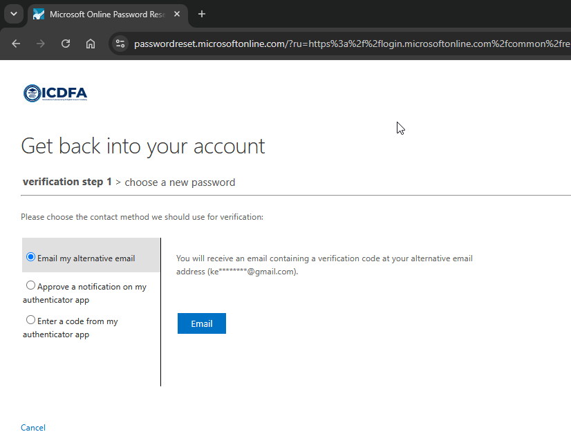

# Self-Service Password Reset (SSPR)

Today, we focus on Self service password reset.
When you lose your password, you can (Most apps and websites) reset password. Now, we embark into the work of an IAM administrator and we enable set the Self-Service Password Reset (SSPR).

---

# What is Self-Service Password Reset (SSPR)

A Self-Service Password Reset is feature (Not limited to Microsoft Entra ID) that allows users to reset their own forgotten passwords or unlock their accounts without contacting the IT help desk.

Without this feature the person would have to ask the IT Service Help Desk for the reset which may take time.

This feature helps user to reset password at their own time of choosing where with saved time productivity increase and also reduce IT support cost. The only thing that they need is correct username and approprite channel to complete verication process. (Where you receive the reset link on your email or OTP.)

A fortune-500 company will opt for this because employees locked out after alot unsuccessfull sign-in attempts, losing device with authentication method(FIDO2 Security Keys, Passkeys & Windows Hello for Business).

Now, if employees in the company request for this then its a repetitive task.

## SSPR TERMINOLOGY

| Term | Meaning | FinTrust example |
|---|---|---|
| SSPR | Self-service password recovery | Alice resets her forgotten password |
| Password reset | Establishing a new password | Alice cannot remember her password |
| Password change | Changing an existing password | Alice changes a known password |
| Registration | Adding authentication information | Alice registers Authenticator |
| Authentication method | A way of proving identity | Authenticator or phone |
| Combined registration | Unified registration experience for MFA and SSPR information | Alice registers her security information in one experience |
| SSPR scope | Users allowed to use SSPR | Pilot group |
| Authentication requirement | Number of methods required during recovery | One or two methods |
| Password writeback | Sending a cloud password update to on-premises AD DS | Hybrid employee changes password |
| Cloud-only identity | Identity managed in Entra ID | FinTrust cloud test account |
| Hybrid identity | Identity connected to cloud and on-premises directories | Employee synchronized from AD DS |
| AD DS | Traditional Windows Server directory service | On-premises company directory |

### HOW DOES SSPR WORKS?

When you decide tho change your password or reset it what is the process?

1. You open the SSPR portal
   
   

2. Entra identifies the user and checks eligibility.
   
   It checks the account and organization and whether the user is included in the SSPR scope.

This user can reset their password because his account is included in the scope of user who can.

This user can't reset their password because his account is not included in the scope of user who can.

3. Authentication-method check
   
   Entra will now confirme whether the user has enough registered information for the configured requirement.
5. Identity verification
   
   The user completes the required verification steps.

6. Password submission
   
   The user submits a new password.
7. Password policy validation
   
   The proposed password must satisfy the applicable password rules.
8. Password update
   
   Entra updates the cloud password or performs the supported hybrid writeback operation.
9. Sign-in verification
   
   The user tests the new credentials.

### Security Consideration

Let's an attacker knows your username but not your password. They decide to reset the passord and then gain access to your account!
Will they be able to reset?
Now that is a seurity consideration.

1. ##### Identity Verification

How do we ensure that the person requesting the password is the legitimate owner? In most SSPR they will ask or use **something that you have**.

What do you have? 
- An email verication
- Microsoft Authenticator
- Mobile phone verication
- Security question

Most SSPR will use only one. Mostly they send you an email with link or OTP.

### Password Change vs Password Reset

Password Change is the volutary changing of the password while Password Reset is usually forced when the user forgets it.

We will continue from this point I show how IAM administer SSPR in the Entra ID to users and Group. That will need a licence Which we currently don't have.
